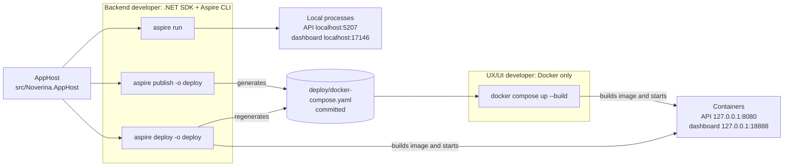
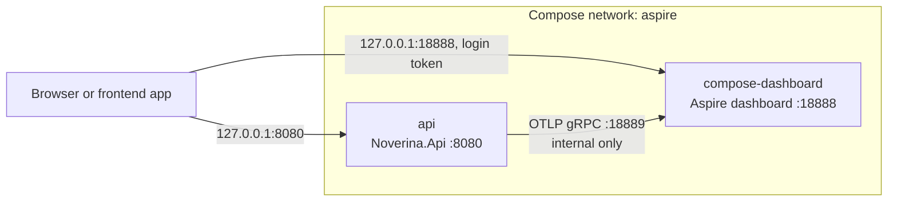

# Noverina

Noverina is a .NET 10 modular monolith: a single Web API plus an Aspire AppHost that
defines the local topology. The Web API owns its own telemetry, health checks, service
discovery, and HTTP resilience configuration directly — there is no separate
ServiceDefaults project, because there is only one host to configure. The AppHost
(`src/Noverina.AppHost`) is the source of truth for how the API runs locally, in
containers, and how the Docker Compose file used by other developers is generated.

## How it fits together

The AppHost drives three ways of running the backend. `aspire publish` and `aspire deploy`
both write `deploy/docker-compose.yaml`, which is committed so Docker-only developers can
run it without the .NET SDK.



Inside Docker Compose, the API sends its logs, traces and metrics to the Aspire dashboard
over the internal network. Only the API and the dashboard UI are published, and only on
`127.0.0.1`.



## Backend developers

### Prerequisites

- .NET 10 SDK. `global.json` pins SDK version `10.0.400` with `rollForward: latestFeature`.
- Aspire CLI 13.5. Install with the official script, or with Homebrew on macOS:

```bash
curl -sSL https://aspire.dev/install.sh | bash
```

```bash
brew install --cask microsoft/aspire/aspire
```

### Run the backend locally

```bash
aspire run --apphost src/Noverina.AppHost
```

The Aspire dashboard login link is printed in the terminal. `dotnet run --project
src/Noverina.AppHost` also works, because the AppHost project references the Aspire CLI
bundle (`AspireUseCliBundle`). Dashboard: `https://localhost:17146`. API:
`http://localhost:5207` / `https://localhost:7015` (from `launchSettings.json`). Endpoints:

- `/health` — readiness
- `/alive` — liveness
- `/openapi/v1.json` — OpenAPI document (Development only)

Stop it with Ctrl+C, or with `aspire stop --apphost src/Noverina.AppHost` from another
terminal.

### Run the backend as containers

```bash
aspire deploy --apphost src/Noverina.AppHost -o deploy --non-interactive --nologo
```

This builds the API image, regenerates `deploy/docker-compose.yaml`, and starts the stack
with Docker Compose under project `aspire-compose-<hash>`. The API is at
`http://127.0.0.1:8080/` and the dashboard at `127.0.0.1:18888` (same ports as the plain
Compose flow below — run only one of the two flows at a time). Find the dashboard login
URL with `docker logs aspire-compose-<hash>-compose-dashboard-1`, using the container name
printed by the deploy command.

Tear the stack down with:

```bash
aspire destroy --apphost src/Noverina.AppHost -o deploy --non-interactive --nologo --yes
```

`aspire destroy` runs `docker compose down` for that deployment and clears the deployment
state, but it does not remove built images. Each `aspire deploy` leaves behind an
`api:<content-hash>` and an `api:aspire-deploy-<timestamp>` image; clean these up
periodically with `docker images 'api'` and `docker rmi`.

### After changing the AppHost

Whenever `AppHost.cs` changes, regenerate the Compose file and commit it:

```bash
aspire publish --apphost src/Noverina.AppHost -o deploy --non-interactive --nologo
```

`deploy/docker-compose.yaml` is what UX/UI developers run — it is deterministic (the same
file is produced by repeated publishes) and must be committed after any AppHost change so
it stays in sync. `aspire deploy -o deploy` also regenerates this file as a side effect of
deploying, so a deploy after an AppHost change covers both.

## UX/UI developers (Docker only)

### Prerequisites

Docker Desktop or Docker Engine with Compose v2. No .NET SDK is required — the API image
is built inside `mcr.microsoft.com/dotnet/sdk:10.0.400` as part of `docker compose up`.

### Run the backend

```bash
git pull
```

```bash
docker compose -f deploy/docker-compose.yaml up --build -d
```

Open the API:

- <http://127.0.0.1:8080/>
- <http://127.0.0.1:8080/openapi/v1.json> (OpenAPI document)

Get the dashboard login URL:

```bash
docker compose -f deploy/docker-compose.yaml logs compose-dashboard
```

Look for the line `Login to the dashboard at http://localhost:18888/login?t=<token>`.

Stop the stack:

```bash
docker compose -f deploy/docker-compose.yaml down
```

After a `git pull` that changed `deploy/docker-compose.yaml` or the API source, rebuild
with the same `up --build -d` command above.

## Good to know

- Both flows (plain Compose and `aspire deploy`) bind the same host ports, `127.0.0.1:8080`
  for the API and `127.0.0.1:18888` for the dashboard, so run only one at a time.
- The dashboard browser token changes every time the dashboard container starts or
  restarts. No keys are stored on disk or in the repository.
- Dashboard telemetry is held in memory only and is cleared on dashboard restart.
- `aspire deploy` leaves one `api:aspire-deploy-<timestamp>` image behind per run; remove
  stale ones with `docker image prune` or `docker rmi` once in a while.
- All ports are bound to `127.0.0.1` only, never exposed beyond the local machine.
- The generated Compose file is local-only: it runs the API with
  `ASPNETCORE_ENVIRONMENT=Development` so the OpenAPI document is served, which is not a
  production setting.

## Package versions

NuGet versions are managed centrally in [Directory.Packages.props](Directory.Packages.props):
add a `PackageVersion` there and a versionless `PackageReference` in the consuming project.
`NuGet.Config` is scoped to nuget.org for the current public dependencies; add any future
private feed explicitly with a source mapping. The `Aspire.AppHost.Sdk` version is declared
separately in the AppHost's own `.csproj` (`<Project Sdk="Aspire.AppHost.Sdk/13.5.4">`),
because NuGet Central Package Management governs package references, not MSBuild SDK
resolution. [Directory.Build.props](Directory.Build.props) holds shared project settings
(`TargetFramework`, `Nullable`, `ImplicitUsings`) common to every project in the solution.
